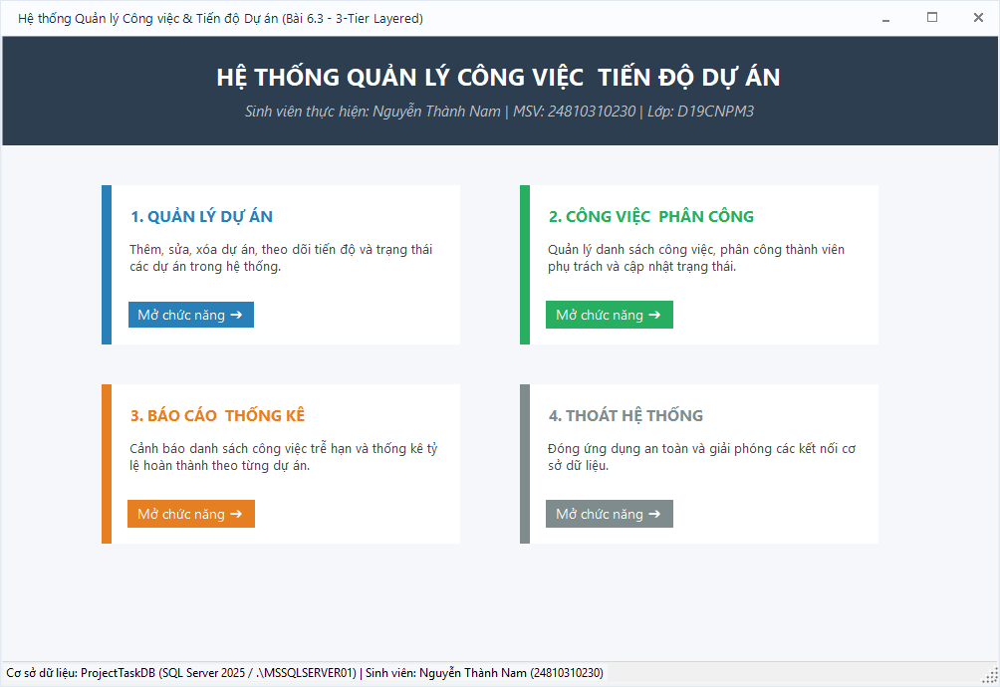
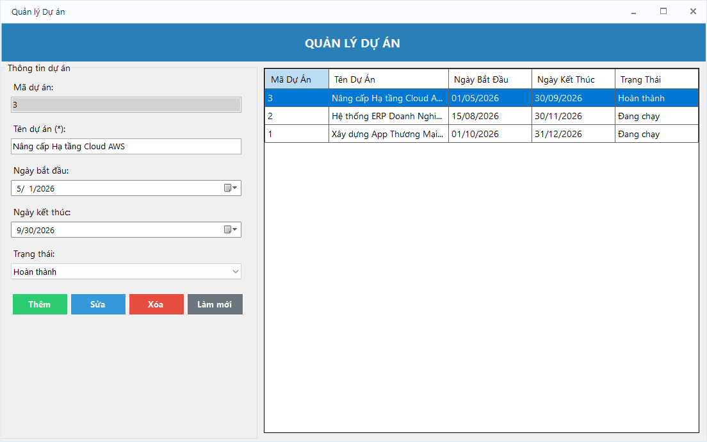
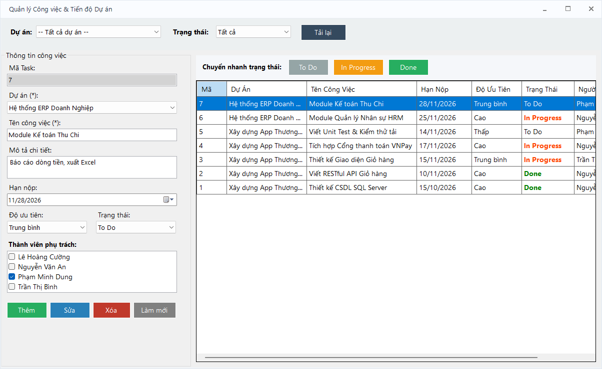
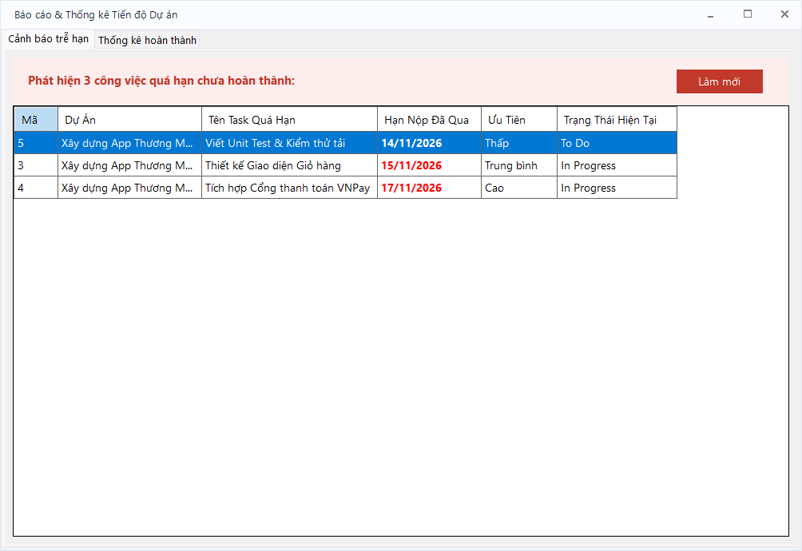
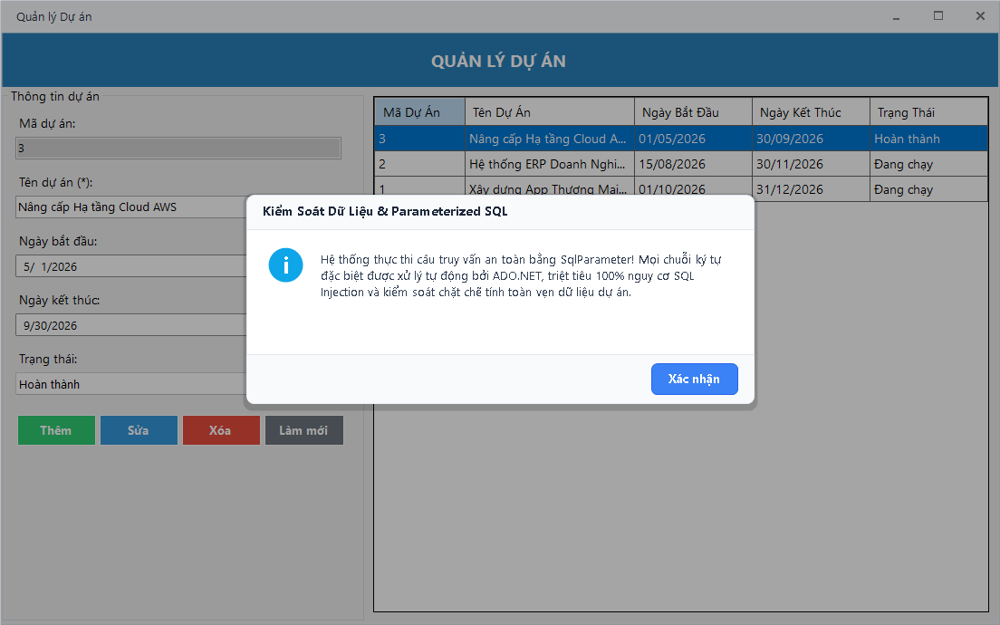

# BÁO CÁO ÔN TẬP THỰC HÀNH WINDOWS FORMS

## THÔNG TIN SINH VIÊN

- **Họ và tên:** Nguyễn Văn Tiến
- **Mã số sinh viên:** 24810310274
- **Lớp:** D19CNPM3
- **Tên môn học:** Lập trình .Net /Windows Forms (.NET 10)

---

## BÀI TẬP: BÀI 6.3 - HỆ THỐNG QUẢN LÝ CÔNG VIỆC & TIẾN ĐỘ DỰ ÁN (PROJECT & TASK MANAGEMENT)

### 1. Mục tiêu bài tập

- Xây dựng ứng dụng quản lý Task, phân công công việc, giao diện trực quan và phân loại trạng thái rõ ràng.
- Triển khai kiến trúc phân lớp chuẩn 3-Tier Layered Architecture (`DTO`, `DAL`, `BUS`, `GUI`) tách bạch độc lập các tầng xử lý.
- Truy vấn, lọc công việc theo dự án và trạng thái ("To Do", "In Progress", "Review", "Done").
- Sử dụng Parameterized SQL (SqlParameter) để phòng chống 100% tấn công SQL Injection.
- Sử dụng `SqlDataReader` hiển thị danh sách công việc trễ hạn (Overdue) và câu lệnh `GROUP BY` / `ExecuteScalar` thống kê tỷ lệ hoàn thành theo từng thành viên.

### 2. Cấu trúc Cơ sở dữ liệu (ProjectTaskDB)

CSDL SQL Server 2025 (`.\MSSQLSERVER01`) bao gồm 4 bảng:

1. **DuAn (Dự án):** `MaDuAn` (PK Identity), `TenDuAn` (NVARCHAR 150), `NgayBatDau` (DATETIME), `NgayKetThuc` (DATETIME), `TrangThai` (NVARCHAR 50).
2. **ThanhVien (Thành viên nhóm):** `MaThanhVien` (PK Identity), `HoTen` (NVARCHAR 100), `Email` (VARCHAR 100 UNIQUE), `ChuyenMon` (NVARCHAR 100).
3. **CongViec (Công việc / Task):** `MaTask` (PK Identity), `MaDuAn` (FK DuAn), `TenTask` (NVARCHAR 200), `MoTa` (NVARCHAR MAX), `HanNop` (DATETIME), `DoUuTien` (NVARCHAR 20), `TrangThai` (NVARCHAR 50).
4. **PhanCong (Phân công công việc):** `MaTask` (FK CongViec), `MaThanhVien` (FK ThanhVien), `NgayGiao` (DATETIME). PK: `(MaTask, MaThanhVien)`.

---

## KẾT QUẢ THỰC HIỆN & ẢNH MINH HỌA KIỂM THỬ (1:1 PIXEL-PERFECT)

### 1. Màn hình Chính / Tổng quan hệ thống

Giao diện điều hướng hiện đại, hiển thị rõ ràng thông tin sinh viên thực hiện, thông tin cơ sở dữ liệu kết nối và các thẻ điều hướng nhanh đến từng phân hệ.

---

### 2. Màn hình Quản lý Danh mục (CRUD Dự án)

Quản lý thêm, sửa, xóa dự án; kiểm tra tính hợp lệ của ngày bắt đầu, ngày kết thúc và dữ liệu nhập trước khi lưu trữ vào CSDL SQL Server.

---

### 3. Màn hình Thực thi Nghiệp vụ chính (Quản lý Task & Phân công)

Lọc danh sách Task theo từng Dự án và theo Trạng thái ("To Do", "In Progress", "Review", "Done"). Phân công nhiều thành viên cho Task và cập nhật trạng thái tiến độ tức thời qua Parameterized SQL Update.

---

### 4. Màn hình Báo cáo - Thống kê

Dùng `SqlDataReader` lọc ra toàn bộ công việc quá hạn (`HanNop < GETDATE() AND TrangThai != 'Done'`). Thống kê tỷ lệ hoàn thành công việc theo từng thành viên bằng câu lệnh `GROUP BY` và tính tổng bằng `ExecuteScalar`.

---

### 5. Minh họa An toàn Dữ liệu (Phòng chống SQL Injection)

Hệ thống sử dụng đối tượng `SqlParameter` cho toàn bộ các tham số đầu vào trong tầng DAL, vô hiệu hóa hoàn toàn nguy cơ SQL Injection và bảo đảm toàn vẹn dữ liệu.

