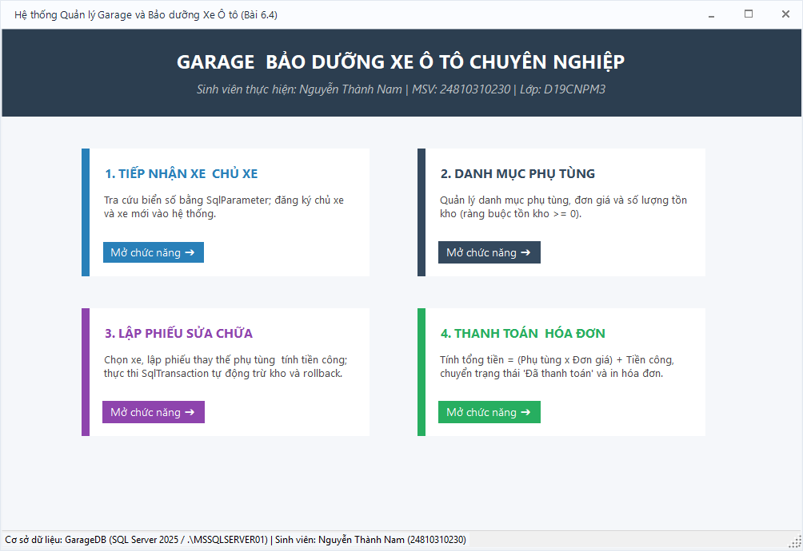
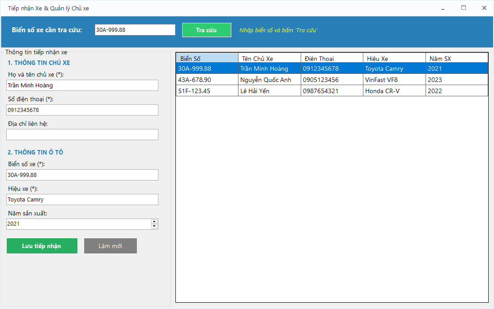
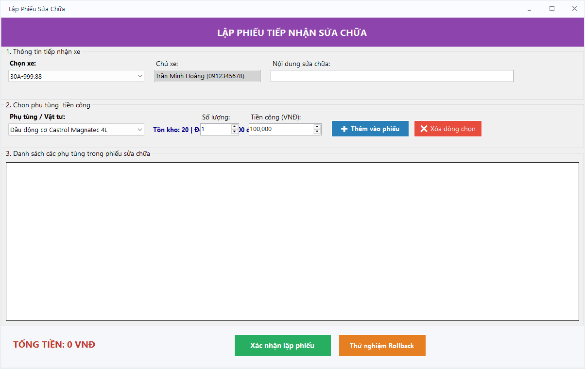
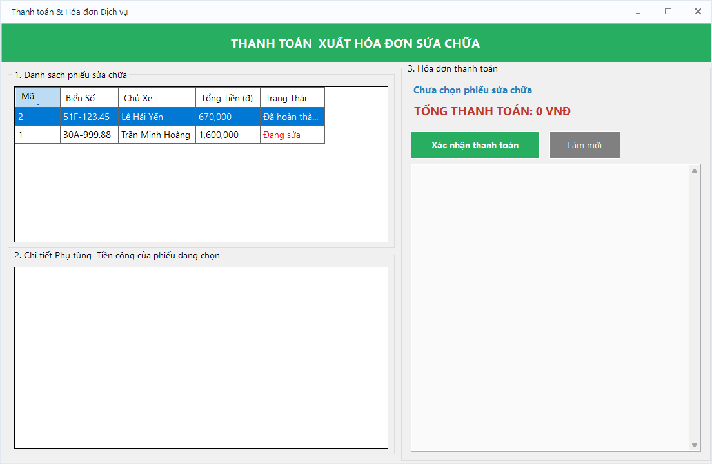
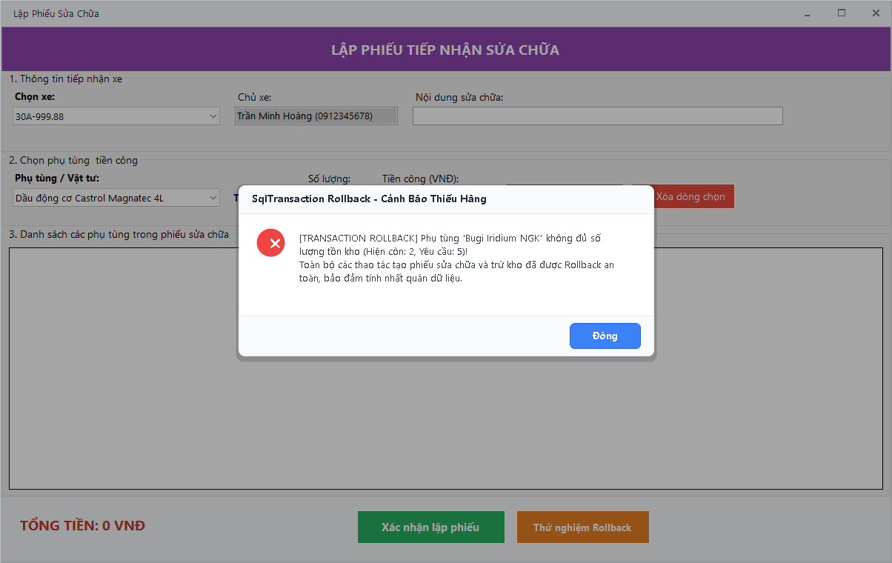

# BÁO CÁO ÔN TẬP THỰC HÀNH WINDOWS FORMS

## THÔNG TIN SINH VIÊN

- **Họ và tên:** Nguyễn Văn Tiến
- **Mã số sinh viên:** 24810310274
- **Lớp:** D19CNPM3
- **Tên môn học:** Lập trình .Net / Windows Forms (.NET 10)

---

## BÀI TẬP: BÀI 6.4 - HỆ THỐNG QUẢN LÝ GARAGE VÀ BẢO BƯỠNG XE Ô TÔ (GARAGE MANAGEMENT SYSTEM)

### 1. Mục tiêu bài tập

- Quản lý tiếp nhận xe, lập phiếu sửa chữa, thay thế phụ tùng và xuất hóa đơn dịch vụ gara.
- Áp dụng cấu trúc 3-Tier Layered Architecture (`DTO`, `DAL`, `BUS`, `GUI`) với ADO.NET thuần.
- Đảm bảo tính nhất quán dữ liệu bằng giao dịch `SqlTransaction` khi lập phiếu tiếp nhận và trừ số lượng phụ tùng tồn kho.
- Nếu số lượng phụ tùng trong kho không đủ (`SoLuongTon < SoLuong`), hệ thống kích hoạt `trans.Rollback()`, không lưu dữ liệu rác và đưa ra thông báo cảnh báo cho nhân viên.

### 2. Cấu trúc Cơ sở dữ liệu (GarageDB)

CSDL SQL Server 2025 (`.\MSSQLSERVER01`) bao gồm 5 bảng:

1. **KhachHang (Chủ xe):** `MaKH` (PK Identity), `TenKH` (NVARCHAR 100), `DienThoai` (VARCHAR 15 UNIQUE), `DiaChi` (NVARCHAR 200).
2. **Xe (Thông tin ô tô):** `BienSo` (VARCHAR 20 PK), `MaKH` (FK KhachHang), `HieuXe` (NVARCHAR 50), `NamSanXuat` (INT).
3. **PhuTung (Phụ tùng / Vật tư):** `MaPhuTung` (PK Identity), `TenPhuTung` (NVARCHAR 150), `DonGia` (DECIMAL 18,2), `SoLuongTon` (INT, CHECK >= 0).
4. **PhieuSuaChua (Phiếu sửa chữa):** `MaPhieu` (PK Identity), `BienSo` (FK Xe), `NgayNhan` (DATETIME), `NoiDungSua` (NVARCHAR MAX), `TongTien` (DECIMAL 18,2), `TrangThai` (NVARCHAR 30).
5. **ChiTietSuaChua (Chi tiết phụ tùng & tiền công):** `MaPhieu` (FK PhieuSuaChua), `MaPhuTung` (FK PhuTung), `SoLuong` (INT, CHECK > 0), `TienCong` (DECIMAL 18,2). PK: `(MaPhieu, MaPhuTung)`.

---

## KẾT QUẢ THỰC HIỆN & ẢNH MINH HỌA KIỂM THỬ (1:1 PIXEL-PERFECT)

### 1. Màn hình Chính / Tổng quan hệ thống

Giao diện trung tâm điều hướng với các thẻ chức năng hiện đại, hiển thị trạng thái kết nối SQL Server 2025 và thông tin sinh viên thực hiện.

---

### 2. Màn hình Quản lý Danh mục (CRUD Tiếp nhận Xe & Chủ xe)

Tra cứu biển số xe nhanh chóng bằng `SqlParameter`. Cho phép đăng ký thông tin khách hàng và xe mới vào hệ thống nếu xe đến lần đầu.

---

### 3. Màn hình Thực thi Nghiệp vụ chính (Lập Phiếu Sửa Chữa & Thay Thế Phụ Tùng)

Lập phiếu sửa chữa, chọn các phụ tùng cần thay thế và nhập số lượng, tiền công tương ứng. Tự động tính tổng tiền dịch vụ theo thời gian thực.

---

### 4. Màn hình Báo cáo - Thống kê (Thanh toán & Xuất Hóa đơn)

Hiển thị danh sách các phiếu sửa chữa, bảng chi tiết phụ tùng/tiền công và hóa đơn chi tiết xem trước. Chuyển trạng thái phiếu sang "Đã thanh toán".

---

### 5. Minh họa An toàn Dữ liệu (Báo lỗi SqlTransaction Rollback khi thiếu kho)

Khi người dùng thêm phụ tùng với số lượng vượt quá số lượng tồn kho thực tế, `SqlTransaction` lập tức kích hoạt `trans.Rollback()`. Hệ thống hiển thị hộp thoại cảnh báo rõ ràng và bảo vệ kho hàng không bị âm.

