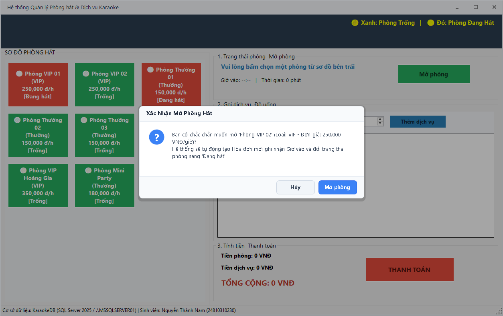
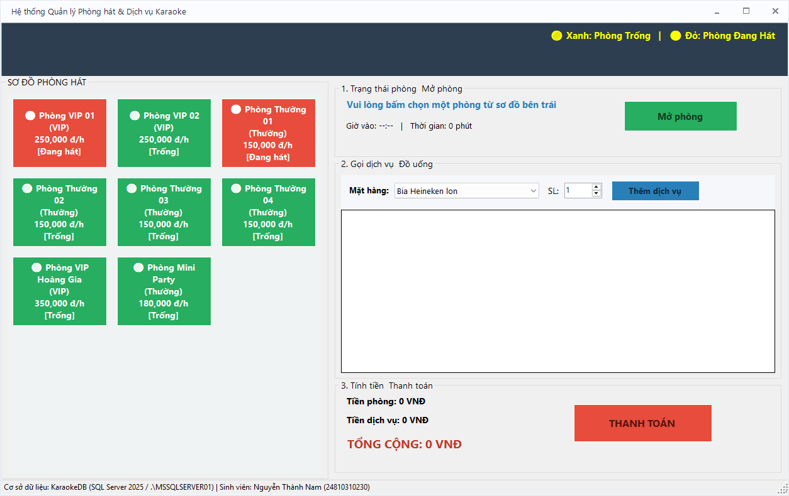

# BÁO CÁO ÔN TẬP THỰC HÀNH WINDOWS FORMS

## THÔNG TIN SINH VIÊN

- **Họ và tên:** Nguyễn Văn Tiến
- **Mã số sinh viên:** 24810310274
- **Lớp:** D19CNPM3
- **Tên môn học:** Lập trình .Net / Windows Forms (.NET 10)

---

## BÀI TẬP: BÀI 6.5 - HỆ THỐNG QUẢN LÝ ĐẶT PHÒNG & DỊCH VỤ KARAOKE (KARAOKE MANAGEMENT SYSTEM)

### 1. Mục tiêu bài tập

- Xây dựng sơ đồ phòng hát trực quan (Visual Room Grid) bằng Windows Forms với danh sách các nút động (Button) thể hiện trạng thái phòng.
  - 🟢 **Phòng Trống (Màu xanh):** Cho phép bấm "Mở phòng" để bắt đầu tính giờ.
  - 🔴 **Phòng Đang hát (Màu đỏ):** Cho phép gọi dịch vụ/đồ uống và thực hiện thanh toán.
- Quản lý tính giờ tự động: Thời gian hát = Giờ ra - Giờ vào, Tiền phòng = (Số giờ) × Giá theo giờ.
- Mô hình ngắt kết nối (Disconnected Model): Sử dụng `SqlDataAdapter` + `DataTable` hiển thị danh sách dịch vụ đã đặt trên `DataGridView`.
- Thanh toán an toàn bằng `SqlTransaction`:
  1. Cập nhật `GioRa`, `TongTienPhong`, `TongTienDichVu`, `TrangThai = 1` cho `HoaDon`.
  2. Trừ `TonKho` tương ứng trong bảng `DichVu`.
  3. Cập nhật trạng thái `PhongHat` về "Trống".
  4. Gọi `trans.Commit()`.

### 2. Cấu trúc Cơ sở dữ liệu (KaraokeDB)

CSDL SQL Server 2025 (`.\MSSQLSERVER01`) bao gồm 4 bảng:

1. **PhongHat (Danh sách phòng hát):** `MaPhong` (PK Identity), `TenPhong` (NVARCHAR 50), `LoaiPhong` (NVARCHAR 30), `GiaTheoGio` (DECIMAL 18,2), `TrangThai` (NVARCHAR 20).
2. **DichVu (Mặt hàng dịch vụ / Đồ uống):** `MaDV` (PK Identity), `TenDV` (NVARCHAR 100), `DonGia` (DECIMAL 18,2), `TonKho` (INT, CHECK >= 0).
3. **HoaDon (Hóa đơn sử dụng):** `MaHD` (PK Identity), `MaPhong` (FK PhongHat), `GioVao` (DATETIME), `GioRa` (DATETIME NULL), `TongTienPhong` (DECIMAL 18,2), `TongTienDichVu` (DECIMAL 18,2), `TrangThai` (BIT).
4. **ChiTietDichVu (Chi tiết dịch vụ gọi):** `MaHD` (FK HoaDon), `MaDV` (FK DichVu), `SoLuong` (INT, CHECK > 0), `DonGia` (DECIMAL 18,2). PK: `(MaHD, MaDV)`.

---

## KẾT QUẢ THỰC HIỆN & ẢNH MINH HỌA KIỂM THỬ (1:1 PIXEL-PERFECT)

### 1. Màn hình Chính / Sơ đồ phòng hát trực quan (Visual Room Grid)

Hiển thị danh sách toàn bộ các phòng hát dạng lưới trực quan với màu sắc phản ánh tức thời tình trạng phòng (Xanh: Trống, Đỏ: Đang hát).

---

### 2. Màn hình Quản lý Danh mục (Mở phòng hát)

Khi chọn một phòng đang ở trạng thái "Trống", hệ thống kích hoạt nút "MỞ PHÒNG". Hộp thoại xác nhận xuất hiện và khi xác nhận, tự động tạo hóa đơn với `GioVao = GETDATE()` và chuyển màu phòng sang Đỏ.

---

### 3. Màn hình Thực thi Nghiệp vụ chính (Gọi Dịch vụ - Disconnected Model)

Sử dụng `SqlDataAdapter` nạp dữ liệu vào `DataTable` ngắt kết nối hiển thị trên `DataGridView`. Cho phép chọn mặt hàng (Bia, Nước ngọt, Đĩa trái cây, Bò khô...) và số lượng để bổ sung vào phòng đang hát.

---

### 4. Màn hình Báo cáo - Thống kê (Tính tiền & Thanh toán Hóa đơn)

Hệ thống tự động tính thời gian hát, tính tiền phòng theo đơn giá giờ của loại phòng tương ứng, cộng dồn tổng tiền dịch vụ và hiển thị tổng tiền cần thanh toán theo thời gian thực.

---

### 5. Minh họa An toàn Dữ liệu (Giao dịch SqlTransaction Khi Thanh Toán)

Khi xác nhận thanh toán, `SqlTransaction` thực hiện nguyên tử 3 thao tác: chốt hóa đơn, trừ tồn kho dịch vụ trong bảng `DichVu` và chuyển trạng thái phòng hát về "Trống", sau đó gọi `trans.Commit()`.

